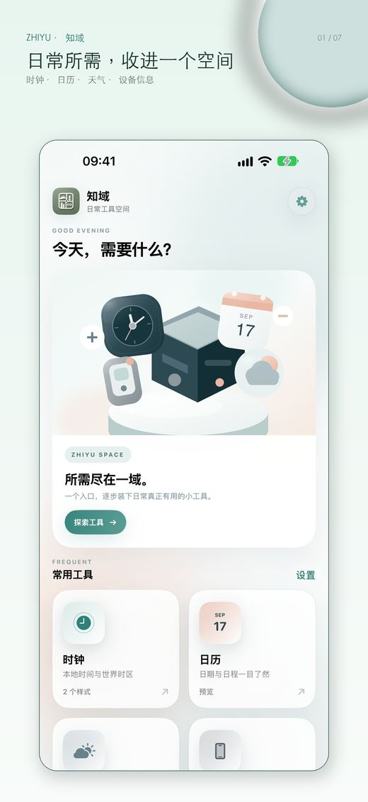

# 知域 · Zhiyu

独立开发者出品，面向 iPhone 与 iPad 的日常工具箱。

[官方网站](https://zzhdong.github.io/zhiyu/) · [使用指南](https://zzhdong.github.io/zhiyu/guides/) · [隐私政策](https://zzhdong.github.io/zhiyu/privacy/) · [技术支持](https://zzhdong.github.io/zhiyu/support/) · [App Store](https://apps.apple.com/hk/app/%E7%9F%A5%E5%9F%9F-%E5%B7%A5%E5%85%B7%E7%AE%B1/id6799164439)

[Official website](https://zzhdong.github.io/zhiyu/en/) · [Guides](https://zzhdong.github.io/zhiyu/en/guides/) · [Privacy](https://zzhdong.github.io/zhiyu/en/privacy/) · [Support](https://zzhdong.github.io/zhiyu/en/support/)

日历、天气、设备信息、小组件、单位换算、二维码、图片处理与滚动截屏。2026.10.22 已通过 App Store 审核；前往商店查看所在地区的可用版本。心率和噪音仅供日常估算。
